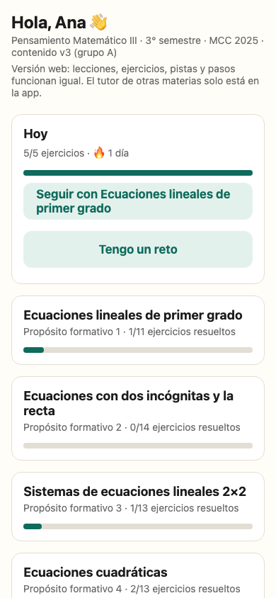
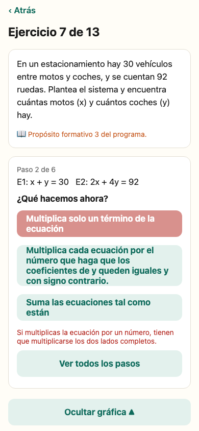
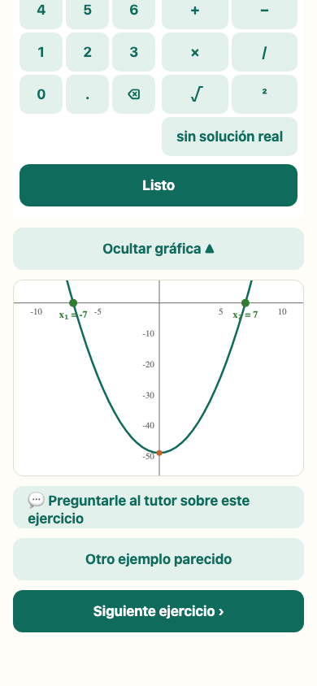
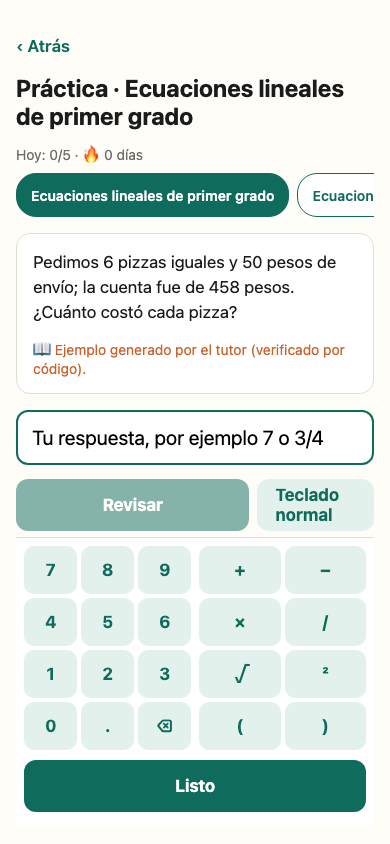
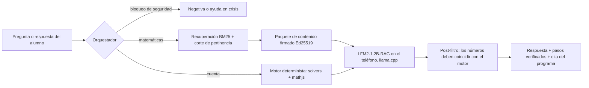

# EduKmx — tutor de matemáticas de bachillerato que funciona sin internet

**EduKmx** es un tutor de matemáticas para bachillerato mexicano que corre **completo dentro del teléfono del alumno, sin conexión y sin costo**. Está alineado al programa oficial *Pensamiento Matemático* del Marco Curricular Común de la Educación Media Superior (SEP, MCC 2025).

> *An offline, on-device math tutor for Mexican high-school students. Deterministic math engine + small local LLM (llama.cpp), signed content packs aligned to the national curriculum.*

| | |
|---|---|
| **Pruébala en el navegador** | [edukmx-app.pages.dev](https://edukmx-app.pages.dev) (funciona sin conexión después de la primera visita) |
| **Presentación del proyecto** | [edukmx.pages.dev/conoce](https://edukmx.pages.dev/conoce) |
| **Estado** | Versión 0.3.2 (Android) y versión web publicadas · piloto con un grupo de 3er semestre, octubre–noviembre 2026 |
| **Autor** | Alejandro Rojas Carranza · [Agentik.mx](https://agentik.mx) |

> **Código fuente:** el repositorio de la aplicación es privado mientras dura el piloto con alumnos reales. Está disponible para comisiones evaluadoras e instituciones a solicitud. Aquí está la descripción del proyecto, su arquitectura y su avance verificable.

---

## El problema

Muchos alumnos de bachillerato tienen un teléfono, pero no tienen datos móviles suficientes ni internet confiable en casa o en la escuela. Las herramientas de IA para estudiar dependen de la nube, y los modelos de lenguaje **se equivocan en aritmética con mucha seguridad**. Un tutor que da una cuenta mal le enseña al alumno a desconfiar o, peor, a aprender algo incorrecto.

## La idea central: "el modelo es la boca, no el cerebro"

En EduKmx **ningún número llega al alumno sin que lo verifique código determinista**.

- **Las cuentas las hace el motor matemático**: ecuaciones lineales, sistemas 2×2, cuadráticas, aritmética, raíces y geometría, con solvers propios y bibliotecas probadas.
- **El conocimiento vive en paquetes de contenido** alineados a los propósitos formativos del programa oficial, con redacción propia, y **firmados digitalmente (Ed25519)**. La app rechaza cualquier contenido que no venga firmado.
- **El modelo de lenguaje** (LFM2-1.2B-RAG de Liquid AI, ejecutado con llama.cpp **dentro del teléfono**) solo explica y reformula. Si el teléfono no tiene memoria suficiente, la app funciona completa sin modelo.
- **Cada respuesta cita su fuente**: "Programa Pensamiento Matemático III, propósito formativo N".

## Qué ve el alumno

- **Paso a paso guiado con diagnóstico del error.** No solo dice "incorrecto": identifica qué hizo mal el alumno (por ejemplo, multiplicar solo un lado de la ecuación) y se lo explica.
- **Teclado matemático propio** (√, ², paréntesis, "sin solución real") y **gráficas deterministas** de rectas, sistemas, parábolas y triángulos.
- **Práctica adaptativa** con racha diaria y **repaso espaciado** (1, 3, 7 y 14 días).
- **Retos entre compañeros** por código o link, que funcionan sin servidor.
- **Tutor dentro del ejercicio**, también para otras materias (historia, ciencias, español). En esas materias avisa explícitamente al alumno que la respuesta no está verificada.
- **Filtros de seguridad** que nunca llegan al modelo: crisis y autolesión (con respuesta propia que remite a una persona de confianza), datos personales, opiniones políticas o religiosas y charla fuera de tema.

## Arquitectura

| Capa | Tecnología |
|---|---|
| App Android | React Native / Expo, SQLite, llama.rn (llama.cpp) |
| Versión web | Expo web + PWA, IndexedDB, service worker propio, sin conexión |
| Núcleo | TypeScript puro y compartido entre la app y la web: motor matemático, orquestador, práctica, contenido firmado |
| Modelo | LFM2-1.2B-RAG, cuantizado Q4_0 (696 MB), en el dispositivo |
| Distribución | Cloudflare Pages + R2 si hay internet; **servidor local en la laptop del profesor con portal cautivo y QR** si no lo hay; el contenido nuevo se puede compartir por WhatsApp |

**Tres formas de llegar al alumno, todas sin tienda de apps:** link o QR público, servidor de escuela sin internet, o el navegador.

## Calidad verificable

| Métrica | Valor (1 de octubre de 2026) |
|---|---|
| Pruebas automatizadas | **701** (37 archivos), todas en verde |
| Cobertura del núcleo | **99.3 %** de líneas · 90.7 % de ramas |
| Evaluación del modelo con preguntas de bachillerato | 3.8 / 5 (24 preguntas calificadas a mano) |
| Paquetes de contenido | 6 temas del 3er semestre (propósitos formativos 1–6), 81 ejercicios |
| Desarrollo | 18 tareas documentadas, cada una cerrada con pruebas y revisión de código |

**Hallazgos de la evaluación que cambiaron el producto:**
- El modelo inventó una fórmula de pendiente con números del contexto. Por eso, desde entonces, el tutor **siempre** muestra debajo de la explicación del modelo los pasos verificados por código.
- En historia de México el modelo se equivocó en 3 de 14 preguntas y dio dos respuestas distintas a la misma pregunta. Por eso el aviso de "respuesta no verificada" es parte del diseño y no un detalle de la interfaz.

## Hoja de ruta

1. **Piloto (oct–nov 2026):** un grupo de 3er semestre usa la app con sus propios teléfonos; se miden el uso, los errores frecuentes y el avance por tema.
2. **Más semestres:** los semestres 1, 2, 4, 5 y 6 ya están planeados por temas, con lo que el motor ya cubre y lo que falta construir.
3. **Para el profesor:** un panel de avance del grupo y el "reto de la semana".
4. **Escala:** paquetes de contenido por plantel y por región, distribuidos sin internet.

## Contenido y derechos

Los paquetes citan textualmente los propósitos y contenidos formativos del programa oficial de la SEP, con atribución, como permite su licencia. Todas las explicaciones, ejemplos y ejercicios son de redacción propia; no se usa material de libros de editoriales privadas.

---

© 2026 Alejandro Rojas Carranza. Todos los derechos reservados. Contacto para acceso al código o para pilotos en planteles: alrojas68@gmail.com
